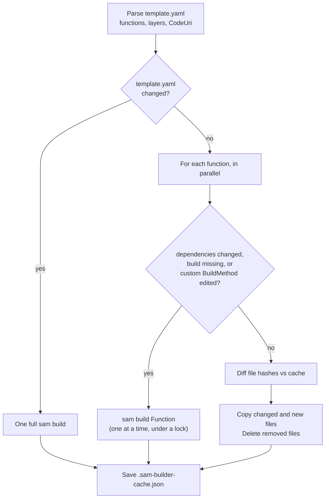

# SAM Fast Builder


**Incremental builds for AWS SAM.** It cuts the edit → build loop from about a minute to well under a second when you've only changed code.

## Why I built it

My backend (for Evior, my AI hiring platform) had many Lambda functions. Every `sam build --use-container` started Docker and reinstalled every function's dependencies, roughly 30–60 seconds, even after changing a single line. Most edits don't touch dependencies at all, so most of that time was wasted.

`sam-builder` fingerprints each function and does the least work that is still correct:

| What changed | What it does | Typical time |
|---|---|---|
| Nothing | Skips | instant |
| Only source files | Copies the changed files into `.aws-sam/build`, removes deleted ones | ~0.1 s |
| `requirements.txt` / `package.json` | `sam build <Function>` for **that function only** | ~30–60 s for that one |
| A layer's code or dependencies | `sam build <Layer>` | per layer |
| `template.yaml` | One full `sam build` | full build |
| A function with `Metadata: BuildMethod` (esbuild, makefile) | `sam build <Function>`, never a raw copy | per function |

## How it works



## Correctness details

A fast build is only useful if it produces the same result as a real one. Version 2.1 fixed the cases where the fast path could deploy something wrong:

- **Builds never run concurrently.** Every `sam build` rewrites the shared `.aws-sam/build/template.yaml`, so parallel runs could corrupt the build. File copying stays parallel; `sam build` calls are serialized with a lock.
- **Template edits trigger a full build.** A new handler, environment variable or resource lives in the template, not in the copied source, so the fast path alone would deploy stale configuration.
- **Deleted and renamed files are removed** from the build folder instead of being deployed forever.
- **Layer code changes rebuild the layer.** Previously only dependency changes did, so edited layer code never shipped.
- **esbuild and makefile functions are never raw-copied**, because their build output isn't the source.
- **A failed build is retried on the next run**, because the cache only records a resource after it builds successfully.

Each case has an end-to-end test that runs against a fake `sam` CLI recording every call, including one that asserts no two builds ever overlap.

## Install

Requires Python 3.8+ and the [AWS SAM CLI](https://docs.aws.amazon.com/serverless-application-model/latest/developerguide/install-sam-cli.html).

```bash
git clone https://github.com/eviorthegg/sam-fast-builder
cd sam-fast-builder
pip install -e .
```

<details>
<summary>Windows: if <code>sam-builder</code> isn't found after installing</summary>

Add Python's user Scripts folder to your PATH, then restart the terminal:

```powershell
[Environment]::SetEnvironmentVariable(
    "Path",
    $env:Path + ";" + $(python -c "import sysconfig; print(sysconfig.get_path('scripts', 'nt_user'))"),
    "User"
)
```
</details>

## Usage

Run it from your SAM project folder, where `template.yaml` lives:

```bash
sam-builder                 # incremental build
sam-builder --sync-cache    # project already built? record its state without building
sam-builder --force         # sam build for every resource
sam-builder --clear-cache   # forget everything, rebuild from scratch
sam-builder --no-container  # run sam build without --use-container
sam-builder -v              # verbose: shows every file copied or removed
sam-builder -j 16           # parallel workers for copying (default 8)
```

Then deploy as usual with `sam deploy`. A full log of each run is written to `sam-builder.log`.

## Cache

`.sam-builder-cache.json` stores only MD5 fingerprints (change detection, not security): one for the template, one per dependency file, and one per tracked source file. Add it to `.gitignore`.

## Development

```bash
pip install pyyaml pytest
python -m pytest -q
```
